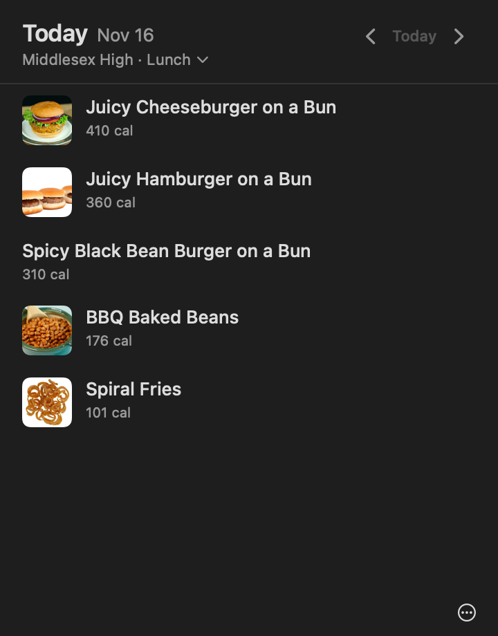
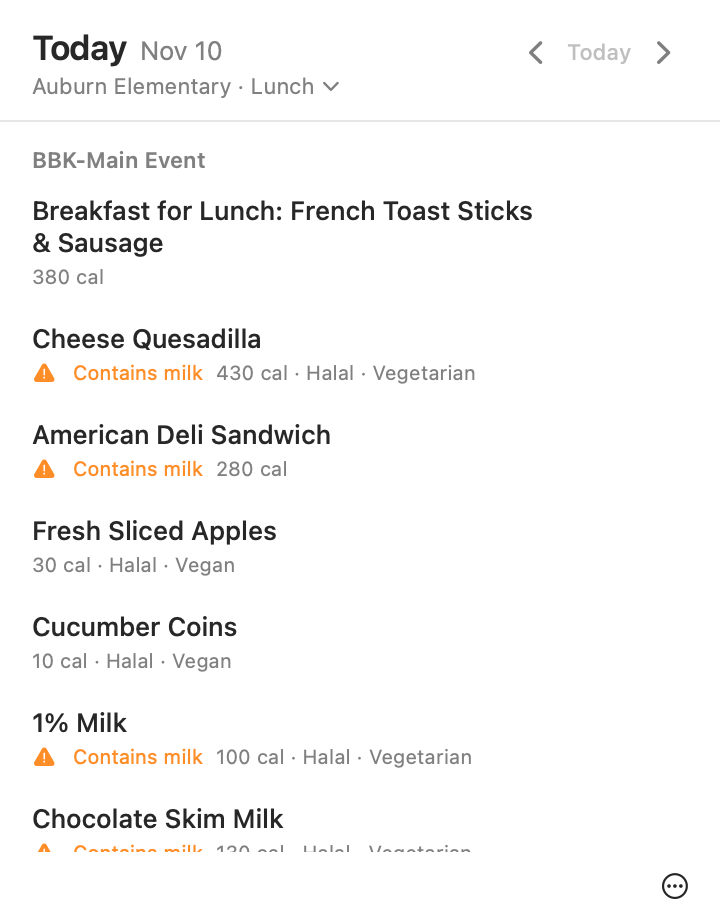
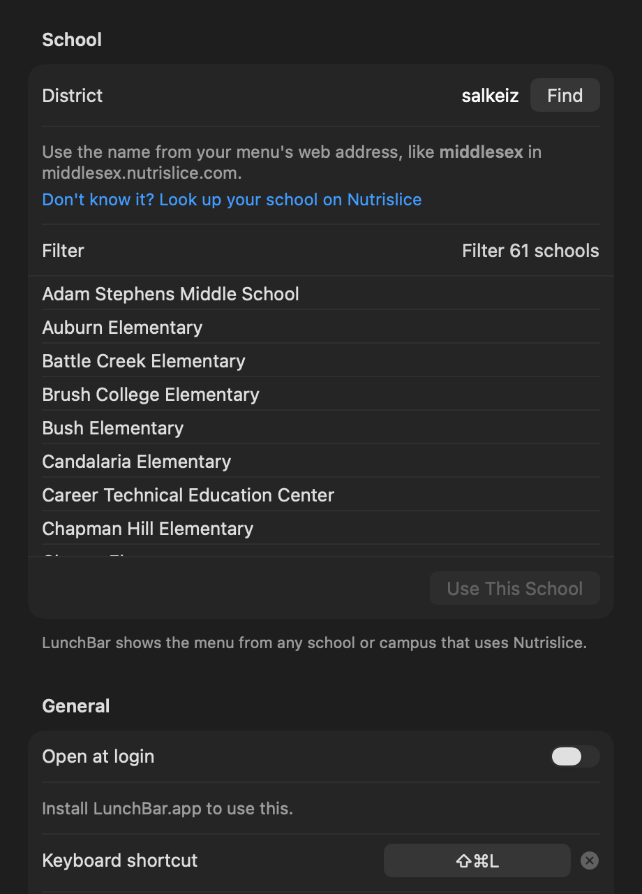

# LunchBar

A tiny Mac menu bar app that tells you what's for lunch. Click the fork and knife (or press ⌘⇧L) and today's school menu drops down. No browser, no tabs, no clicking through the Nutrislice site every single morning.

I originally built it for my own high school's menu. It now works with any school, district or campus dining hall that publishes its menu on [Nutrislice](https://nutrislice.com).

<p>
  
  
</p>

## What it does

- Opens straight to today's menu. On weekends it jumps to Monday instead of showing you an empty Saturday.
- ← and → browse days, T jumps back to today. Weekends are skipped unless you turn that off (dining halls that serve every day exist).
- Switch between a school's menus (lunch, breakfast, the grill, whatever your cafeteria publishes) from the popover.
- Click an item for calories, nutrition facts, ingredients and allergens, when your district publishes them.
- Pick allergens to avoid and items that contain them get flagged. Vegan, vegetarian and halal tags show up when the district marks them.
- Star a favorite and get a 7:30 AM notification on days it's served. (Chicken patty day deserves a heads up.)
- Menus you've opened stay available offline, with a note that you're looking at a saved copy.
- Holidays and days off come from your district's own calendar, so "Thanksgiving" shows up when your school says so.
- Launch at login, a recordable global shortcut, text size options, light and dark mode, VoiceOver labels and full keyboard navigation.

It sits at 0% CPU and about 12 MB of memory while idle (measured below), and it only talks to the network when you actually look at it.

## Install

Requires macOS 14 Sonoma or newer.

### Download

Grab the latest zip from [Releases](https://github.com/trevor050/LunchBarApp/releases), unzip it and drag **LunchBar.app** into Applications.

LunchBar isn't signed with an Apple Developer ID or notarized (that costs $99 a year, and this is a free side project). The first time you open it, macOS will say it can't verify the app and won't open it. To allow it:

1. Try to open LunchBar once and dismiss the warning.
2. Open **System Settings → Privacy & Security**, scroll down to the message about LunchBar and click **Open Anyway**.
3. Confirm with your password or Touch ID.

You only do this once. If you'd rather not, build it yourself (next section): apps you build locally don't get the warning.

### Build from source

You need Xcode 16 or newer, or just the Command Line Tools (`xcode-select --install`).

```bash
git clone https://github.com/trevor050/LunchBarApp.git
cd LunchBarApp
scripts/install.sh   # builds dist/LunchBar.app, copies it to ~/Applications and opens it
```

`scripts/build-app.sh` does the same build without installing, and also writes a zip to `dist/`.

To uninstall, quit LunchBar (right-click the menu bar icon → Quit), turn off **Open at login** if you enabled it, and delete the app.

## Point it at your school

On first launch LunchBar opens Settings and asks for your district:



1. Open your school's menu on the web. The address looks like `https://middlesex.nutrislice.com/menu/...`. The part before `.nutrislice.com` is the district (here, `middlesex`).
2. Type that into LunchBar, or just paste the whole menu link. Pasting a link to a specific menu preselects the school and menu type too.
3. Pick your school and menu, then **Use This School**.

Don't know your district's address? Find your school on [Nutrislice's lookup page](https://lookup.nutrislice.com/), open its menu, and copy the link.

LunchBar can't search every district itself, because Nutrislice's own district search requires a CAPTCHA. Everything after the district name (schools, menu types, menus) comes from Nutrislice's public menu API.

Upgrading from LunchBarApp 1.x? Your old `config.env` is imported automatically the first time 2.0 runs.

## How it gets the menu

Each district has a public, unauthenticated API at `https://<district>.api.nutrislice.com/menu/api/`. LunchBar uses three endpoints:

| Endpoint | Used for |
| --- | --- |
| `schools/` | Schools in the district and their menu types |
| `settings/?format=json` | The district's display name |
| `weeks/school/<school>/menu-type/<type>/<yyyy>/<mm>/<dd>/` | One Sunday-to-Saturday week of menus |

It tries to be a polite guest:

- A whole week comes back in one request, so browsing days inside a week doesn't hit the network.
- Weeks are cached on disk and refreshed at most once an hour, only when you open the popover.
- There's no polling. With favorite notifications on, it checks once a day (at launch, on wake and at 6 AM), which usually hits the cache.
- Requests identify themselves with a `LunchBar/2.0` user agent that links back here.

## Resource use

Measured on a 2020 M1 MacBook Air running macOS 26.5, with the release build sitting idle in the menu bar after launch:

| Metric | Value | How |
| --- | --- | --- |
| CPU time over 60 s idle | 0.00 s | `ps -o time= -p $(pgrep -x LunchBar)`, sampled 60 s apart |
| Memory footprint | 12 MB | `footprint $(pgrep -x LunchBar)` |
| App size (arm64 build) | 2.2 MB unzipped, 0.8 MB zipped | `scripts/build-app.sh` output |

## Development

```bash
scripts/test.sh          # unit tests (Swift Testing), works with Xcode or the Command Line Tools
scripts/build-app.sh     # dist/LunchBar.app + zip; add --universal for arm64 + x86_64 (needs Xcode)
swift run LunchBar       # run without bundling (login items and notifications are disabled)
```

The code is split in two targets:

- `Sources/LunchKit`: the Nutrislice client, JSON parsing, the disk cache, date math and link parsing. No UI, fully covered by tests in `Tests/LunchKitTests`, which run against recorded API responses from three districts in `Tests/LunchKitTests/Fixtures`.
- `Sources/LunchBar`: the AppKit status item and popover, SwiftUI views, settings, global hotkey, login item and notifications.

The README images come from the app's own snapshot mode, which renders the real popover with live data in light and dark mode:

```bash
swift run LunchBar --render-snapshots /tmp/shots middlesex middlesex-high lunch 2026-11-16
```

Releases are built by GitHub Actions when a `v*` tag is pushed. CI builds and tests every pull request.

### Signing, if you ever want to

The release zip is ad-hoc signed only. Shipping it without the Gatekeeper prompt would need an Apple Developer Program membership, a Developer ID Application certificate, signing with the hardened runtime (`codesign --options runtime`), notarizing with `xcrun notarytool submit`, and stapling the ticket (`xcrun stapler staple`). The release workflow is the place to add those steps.

## Disclaimer

LunchBar is an unofficial tool. It isn't affiliated with, endorsed by, or supported by Nutrislice. Menus, nutrition and allergen information come straight from what your district publishes and can be wrong or change, so check with cafeteria staff if an allergy matters.

## License

[MIT](LICENSE)
