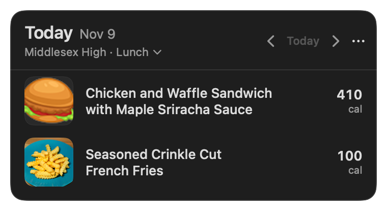
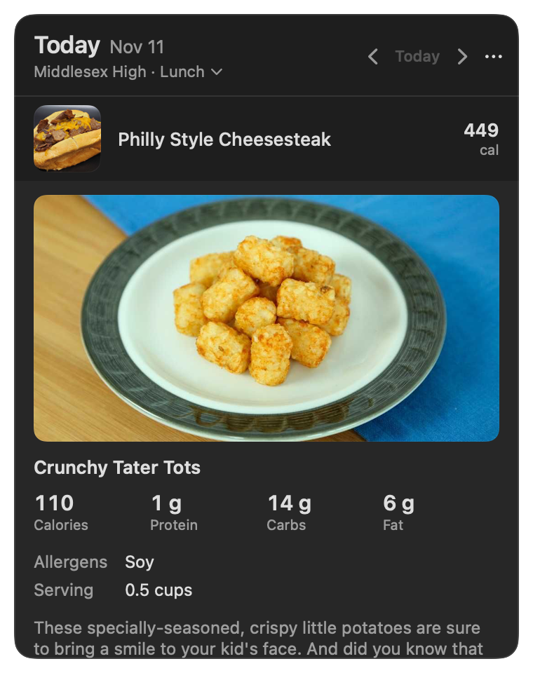
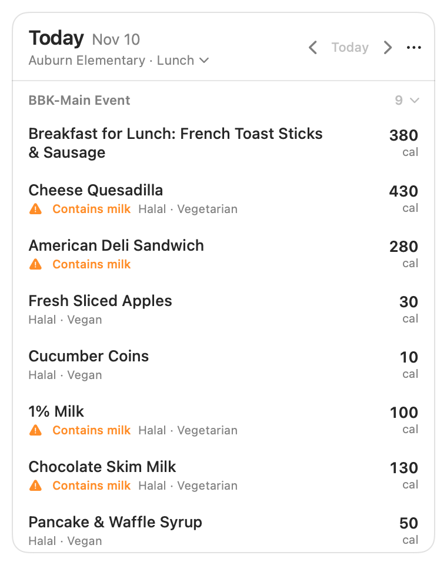
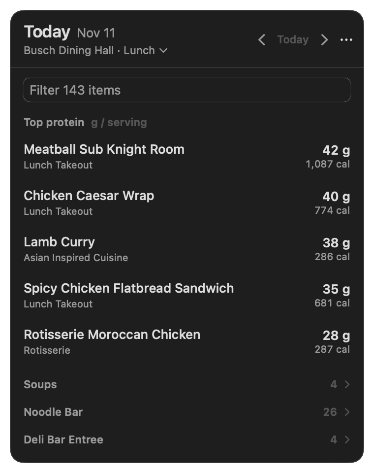

# LunchBar

A tiny Mac menu bar app that tells you what's for lunch. Click the fork and knife (or press ⌘⇧L) and today's school menu drops down. No browser, no tabs, no clicking through the Nutrislice site every single morning.

I originally built it for my own high school's menu. It now works with Nutrislice schools and Rutgers dining halls, including the older FoodPro menus. Rutgers’ current official menu links now go to Nutrislice too, so The Atrium is in the Rutgers current-menu picker.

<p>
  
  
</p>
<p>
  
  
</p>

## What it does

- Opens straight to today's menu. On weekends it jumps to Monday instead of showing you an empty Saturday.
- ← and → browse days, T jumps back to today. Weekends are skipped unless you turn that off (dining halls that serve every day exist).
- Save several places, then switch place or meal from the header. Your existing school is saved automatically.
- Every item shows its calories on the right, where you can scan them, next to the food photo when the district publishes one.
- Top picks ranks a big menu by your goal: high protein, lean protein, low calorie, low carb, high fiber, low sugar or low sodium. Pick it right from the group's heading. The "low" goals only count real meals and sides, so the answer isn't five condiments and a cup of water. It only shows up on menus big enough for it to help (at least eight ranked items, and never most of the menu). [Exact rules](docs/research/top-picks.md).
- Large menus get a name filter and collapsible stations, collapsed by default above 25 items. Station choices are remembered.
- Small ounce portions at explicitly ingredient/build-your-own stations are excluded from the ranking, while remaining in the full menu. Entree stations, EACH/SLICE servings and portions over 2 OZ remain eligible. [Exact rule and limits](docs/research/top-picks.md).
- Click an item for a big photo, calories, protein, carbs and fat at a glance, and allergens. The full nutrition label and ingredients are one more click away.
- Pick allergens to avoid and items that contain them get flagged. Vegan, vegetarian and halal tags show up when the district marks them.
- Star a favorite and get a 7:30 AM notification on days it's served. (Chicken patty day deserves a heads up.)
- Menus you've opened stay available offline, with a note that you're looking at a saved copy.
- Holidays and days off come from your district's own calendar, so "Thanksgiving" shows up when your school says so.
- Launch at login, a recordable global shortcut, text size options, light and dark mode, VoiceOver labels and full keyboard navigation.

FoodPro only loads when you use the menu. Nutrislice can also check favorites in the background when you enable notifications.

## Install

Requires macOS 14 Sonoma or newer.

### Download

Grab the latest zip from [Releases](https://github.com/trevor050/LunchBarApp/releases), unzip it and drag **LunchBar.app** into Applications.

LunchBar isn't signed with an Apple Developer ID or notarized (that costs $99 a year, and this is a free side project). The first time you open it, macOS will say it can't verify the app and won't open it. To allow it:

1. Try to open LunchBar once and dismiss the warning.
2. Open **System Settings → Privacy & Security**, scroll down to the message about LunchBar and click **Open Anyway**.
3. Confirm with your password or Touch ID.

You only do this once. If you'd rather not, build it yourself (next section): apps you build locally don't get the warning.

### Build from source

You need Xcode 16 or newer, or just the Command Line Tools (`xcode-select --install`).

```bash
git clone https://github.com/trevor050/LunchBarApp.git
cd LunchBarApp
scripts/install.sh   # builds dist/LunchBar.app, copies it to ~/Applications and opens it
```

`scripts/build-app.sh` does the same build without installing, and also writes a zip to `dist/`.

To uninstall, quit LunchBar (right-click the menu bar icon → Quit), turn off **Open at login** if you enabled it, and delete the app.

## Point it at your school

On first launch LunchBar opens Settings and asks for your district:


1. Open your school's menu on the web. The address looks like `https://middlesex.nutrislice.com/menu/...`. The part before `.nutrislice.com` is the district (here, `middlesex`).
2. Type that into LunchBar, or just paste the whole menu link. Pasting a link to a specific menu preselects the school and menu type too.
3. Pick your school and menu, then **Use This School**.

Don't know your district's address? Find your school on [Nutrislice's lookup page](https://lookup.nutrislice.com/), open its menu, and copy the link.

LunchBar can't search every district itself, because Nutrislice's own district search requires a CAPTCHA. Everything after the district name (schools, menu types, menus) comes from Nutrislice's public menu API.

For Rutgers, choose **Add Place → Rutgers · current menus** in Settings to pick Busch, Livingston, Neilson or The Atrium. Choose **Rutgers · FoodPro** for the three verified older-portal halls. FoodPro’s Atrium ID could not be verified, so it isn’t guessed. Rutgers places browse weekends even if your old high school skips them.

Upgrading from LunchBarApp 1.x? Your old `config.env` is imported automatically the first time 2.0 runs.

## How it gets the menu

Each district has a public, unauthenticated API at `https://<district>.api.nutrislice.com/menu/api/`. LunchBar uses three endpoints:

| Endpoint | Used for |
| --- | --- |
| `schools/` | Schools in the district and their menu types |
| `settings/?format=json` | The district's display name |
| `weeks/school/<school>/menu-type/<type>/<yyyy>/<mm>/<dd>/` | One Sunday-to-Saturday week of menus |

It tries to be a polite guest:

- A whole week comes back in one request, so browsing days inside a week doesn't hit the network.
- Weeks are cached on disk and refreshed at most once an hour, only when you open the menu.
- There's no polling. With favorite notifications on, it checks once a day (at launch, on wake and at 6 AM), which usually hits the cache.
- Requests identify themselves with a `LunchBar/2.0` user agent that links back here.

### Rutgers FoodPro

FoodPro serves HTML, not a supported API. Station headings become sections. A combined nutrition report supplies individual recipe nutrients, so LunchBar does not request a label for every item just to rank protein. Labels load on expansion; when you avoid an allergen, candidate labels load in ranking order until five eligible choices are known. Unknown labels do not enter that top group while an allergen is selected.

FoodPro requests are serialized, spaced at least 350 ms apart, identify LunchBar and this repository, and back off on errors. There is no FoodPro timer or background fetch. Menus cache per hall/meal/date for an hour; recipe **and portion** nutrition caches for 30 days. Busch lunch on November 11 had 143 items: **3 requests on a cold open, 0 on a warm reopen**, measured with an empty app cache (the snapshot mode prints `requests cold=3 warm=0`). Allergen checking and expanding labels add requests as needed. [Source investigation and fragility](docs/research/rutgers-foodpro.md), [label comparisons](docs/verification/rutgers-label-check.json).

The observed date window was seven days. FoodPro can return menu HTML outside that window, including closed dates; LunchBar checks the published date dropdown and rejects that fallback. Hostnames, markup, form tokens and menu names can change without notice. This adapter can break when they do.

## Resource use

Historical measurements of the Nutrislice-only 2.0 build, before the Rutgers adapter and HTML-parser dependency, on a 2020 M1 MacBook Air running macOS 26.5. These are not measurements of the current build:

| Metric | Value | How |
| --- | --- | --- |
| CPU time used over 60 s idle | 0.00 s and 0.01 s (two runs) | `ps -o time= -p $(pgrep -x LunchBar)`, sampled 60 s apart |
| Memory footprint | 11–12 MB | `footprint $(pgrep -x LunchBar)` |
| Network requests at launch | 0 | no files in `~/Library/Caches/io.github.trevor050.LunchBar` until the menu is opened |
| App size (arm64 build) | 2.2 MB unzipped, 0.8 MB zipped | `scripts/build-app.sh` output |

## Development

```bash
scripts/test.sh          # unit tests (Swift Testing), works with Xcode or the Command Line Tools
scripts/build-app.sh     # dist/LunchBar.app + zip; add --universal for arm64 + x86_64 (needs Xcode)
swift run LunchBar       # run without bundling (login items and notifications are disabled)
```

The code is split in two targets:

- `Sources/LunchKit`: provider interface, Nutrislice and Rutgers FoodPro clients/parsers, protein ranking, caches, date math and link parsing. No UI, tested in `Tests/LunchKitTests`, which run against recorded API responses from three districts in `Tests/LunchKitTests/Fixtures`.
- `Sources/LunchBar`: the AppKit status item and menu window, SwiftUI views, settings, global hotkey, login item and notifications.

The README images come from the app's own snapshot mode, which renders the real menu window content with live data in light and dark mode:

```bash
swift run LunchBar --render-snapshots docs/shots middlesex middlesex-high lunch 2026-11-09
swift run LunchBar --render-snapshots docs/shots middlesex middlesex-high lunch 2026-11-11 --expand tot
swift run LunchBar --render-snapshots docs/shots salkeiz auburn-elementary lunch 2026-11-10 --avoid-milk
swift run LunchBar --render-snapshots docs/shots rutgers-foodpro 04 Lunch 2026-11-11 --goal lowCalorie
# Real hall/meal/day and saved-place matrix, plus Middlesex:
swift run LunchBar --render-snapshots docs/matrix rutgers-foodpro 04 Lunch 2026-11-10 --matrix
# Drives the real status item and menu window through 400 content changes and checks
# its geometry after each one (JSON lines on stdout, exit 1 on the first violation):
dist/LunchBar.app/Contents/MacOS/LunchBar --self-test-panel 400 --right-edge
```

Releases are built by GitHub Actions when a `v*` tag is pushed. CI builds and tests every pull request.

### Signing, if you ever want to

The release zip is ad-hoc signed only. Shipping it without the Gatekeeper prompt would need an Apple Developer Program membership, a Developer ID Application certificate, signing with the hardened runtime (`codesign --options runtime`), notarizing with `xcrun notarytool submit`, and stapling the ticket (`xcrun stapler staple`). The release workflow is the place to add those steps.

## Disclaimer

LunchBar is an unofficial tool, not affiliated with Rutgers University or Nutrislice. Rutgers nutrition figures come from the university’s published labels and reports and **can be wrong**. Other schools’ figures come from their published Nutrislice data. Recipes, portions, availability and allergens can change, and cross-contact is possible. Check with dining staff when an allergy matters; a protein ranking is not a promise that a food is safe.

## License

[MIT](LICENSE)
