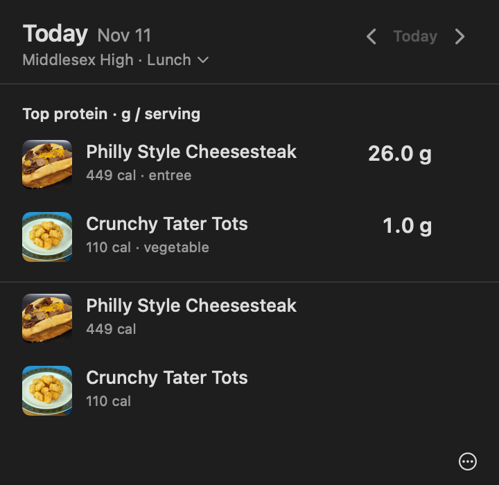
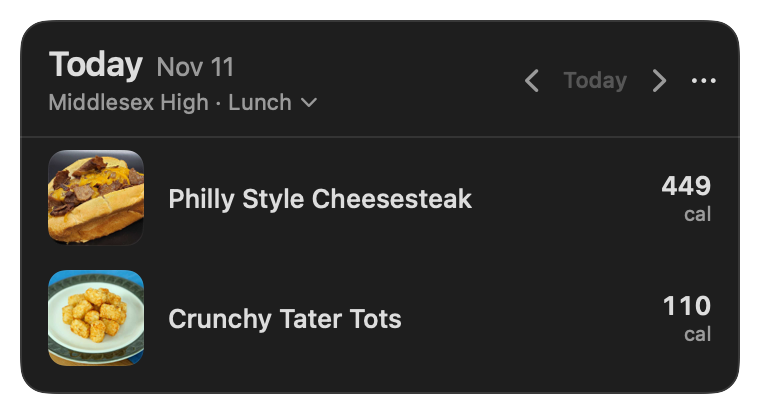
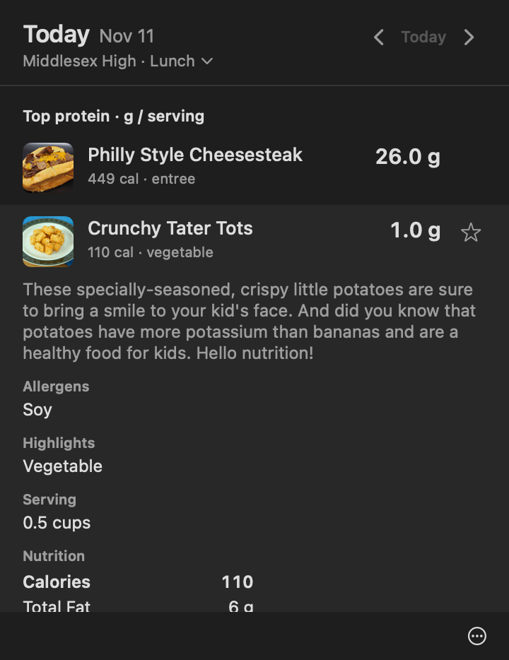
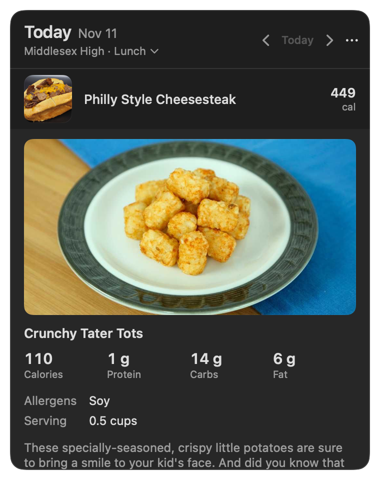
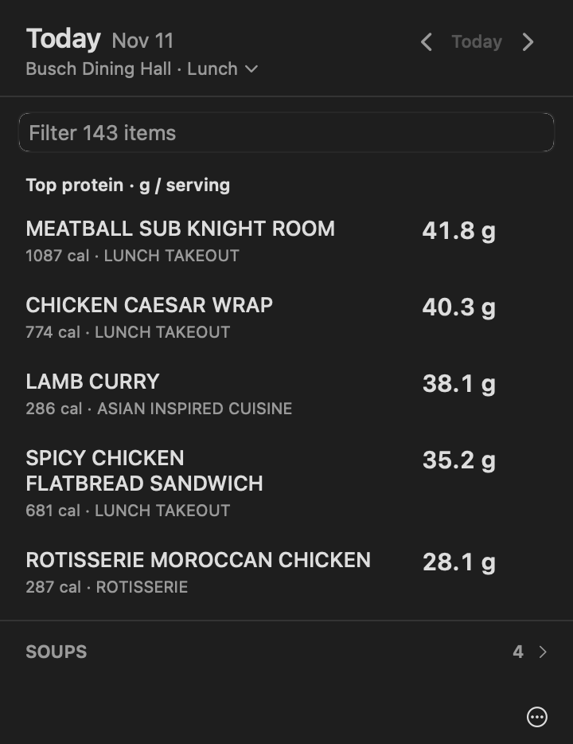
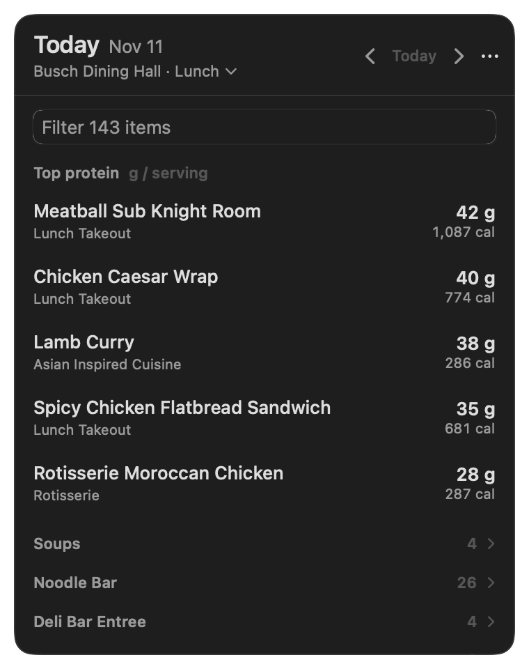

# Menu window verification

The menu used to be an `NSPopover`. Resizing a popover while it is shown against a status item made AppKit misplace it: it detached to the screen corner, and the previous fix needed a guard that corrected its position 507 times in 360 steps. It is now a borderless, non-activating `NSPanel` positioned by the app (`Sources/LunchBar/MenuPanel.swift`). There is no corrective guard.

## Root cause of the cut-off window

The owner's menu bar auto-hides (`_HIHideMenuBar = 1`). While it is hidden, the status item's window sits above the top of the screen: it was observed at y = 900 and y = 932 on a 900-point-high screen. A popover anchored to that window opened partly above the screen, which is the cut-off in the screenshots. The panel takes its vertical position from the screen, not from the status item: just below the visible frame when the menu bar is shown, or below where the menu bar appears (screen top minus the status window's 30-point height) when it auto-hides. The x position follows the icon, clamped to the visible frame. While the panel is open, vertical moves of the status item (the menu bar sliding in or out) do not move it. `Tests/LunchBarTests/PanelGeometryTests.swift` covers hidden and revealed auto-hide positions, a permanently visible menu bar, a notched display, edge clamping and multiple displays.

## Height without a feedback loop

The content reports its natural height from inside the scroll view, where SwiftUI lays it out without a vertical limit, plus the fixed header. The hosting view has `sizingOptions = []`, so the window size never flows back into the measurement. Changes are coalesced into one resize per run-loop turn with the top edge fixed, animated for 0.18 s (no animation with Reduce Motion). A loading state keeps the previous height, so a day change resizes once.

## Self-test on the real status item

```bash
scripts/build-app.sh
dist/LunchBar.app/Contents/MacOS/LunchBar --self-test-panel 400 --right-edge [--no-animation]
```

Each step changes the content (days across very different menus, Middlesex High's 2 items and Busch Dining Hall's 143, expand and collapse, stations, filter text, meal, favorites, switching place, close and reopen). After the step settles it fails on: the top edge or x position moving, any part of the panel outside the visible frame, a height different from the clamped natural height or from an independent offscreen measurement (`PanelMeasure`), more resizes than content updates, any frame change without a content change, and any animation frame that leaves the anchor or reverses direction. It also sends real key events (arrows, Escape) and toggles the status item. It uses its own defaults suite and does not register the hotkey or touch notifications.

Runs on the bundled app, 2026-11-11, menu bar auto-hidden throughout:

| Run | Steps | Result | Resizes | Frame events | Notes |
| --- | --- | --- | --- | --- | --- |
| Animated | 400 | passed | 174, max 2 in a step | 1,434, max 15 in a step | 26 steps had two content arrivals (FoodPro nutrition after the menu); top stayed at 865 |
| No animation | 400 | passed | 174 | max 2 in a step | 0 focus fallbacks |
| Animated | 400 | passed | 174 | 1,411, max 11 in a step | 0 focus fallbacks |
| Animated | 286 | **failed** | | | see below; log in `panel-run-failed-step286.jsonl` |

The step 286 failure was a real bug: whether an expanded item shows its large photo depended on an image cache that SwiftUI did not observe, so an image that finished loading after the row expanded left the window at the compact height while a fresh measurement showed the photo. The cache is now observable. The fix passed the offscreen checks; it was not re-run on screen because the self-test takes keyboard focus and the owner was using the Mac, so further on-screen runs were stopped.

Focus: two earlier bundled runs failed the strict focus check once each (panel shown without key focus when LunchBar was not the active app). The panel now asks to activate the app only if it opened without key focus, and hands activation back to the previous app when it closes. In a short run with LunchBar deliberately deactivated, the panel became key without needing that fallback.

## Needs checking by eye

- Clicking the icon while the menu bar is revealed, and pressing ⌘⇧L while it is hidden: the panel should appear just below the menu bar line under the icon in both cases, and stay put as the menu bar slides away.
- Keyboard focus: typing goes to the panel while it is open (arrows change days, Escape clears the filter then closes), and focus returns to the previous app when it closes.
- Click outside, switching apps and changing Spaces close it. These use system events that the self-test cannot synthesize.
- The vibrant background, border and shadow. Offscreen renders cannot capture vibrancy.
- Increased contrast. SwiftUI reads contrast from the system, so offscreen renders cannot show it.

## Before and after

Offscreen renders of the real views (`--render-snapshots`), same data:

| Before | After |
| --- | --- |
|  |  |
|  |  |
|  |  |
